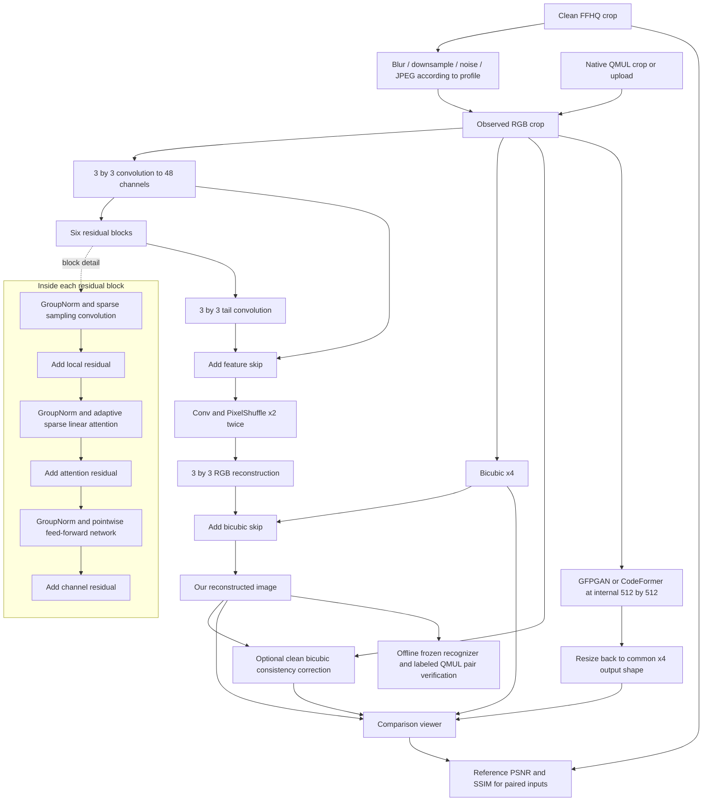

# Face super-resolution with sparse sampling and adaptive linear attention

This project enlarges a low-resolution face crop by **4x**. The comparison app runs our **479,109-parameter v4 model**, **GFPGAN 1.4**, and **CodeFormer** (fidelity weight 0.5) on the same input pixels. Its slider and side-by-side views let you inspect each reconstruction against the input, bicubic enlargement, or an available clean reference.

For a class presentation, start with the [executable walkthrough](notebooks/Walkthrough.ipynb). Its four steps load the released checkpoint, create the observation, run the actual network and score its prediction. The [scorecard](work/final_scores/FINAL_SCORES.md) gives the measured results and explains each metric.

## Run the comparison app

From the repository root on Windows, use the project's tested Python 3.14 environment. The dependency files pin the recorded package versions. A compatible CUDA build of PyTorch enables GPU inference. CPU inference is also supported.

```powershell
py -3.14 -m venv .venv
.\.venv\Scripts\python.exe -m pip install -r requirements.txt
.\.venv\Scripts\python.exe setup_demo.py
.\.venv\Scripts\python.exe comparison_app.py --open-browser
```

The server listens at **http://127.0.0.1:8765**. The repository includes the trained v4 weights. Setup downloads about 725 MB of official baseline weights and checks each file against its recorded SHA-256 digest. Once the weights are present, the app runs locally. Use **Your image** to try an upload immediately. Subsequent launches can use [Open_Comparison_UI.cmd](Open_Comparison_UI.cmd).

For the paired FFHQ gallery and walkthrough, run the following command and restart the app. It downloads FFHQ128 and builds a local uint8 cache. The cache alone needs about 3.44 GB. Allow additional space for the download.

```powershell
.\.venv\Scripts\python.exe prepare_data.py
```

The gallery opens on four labeled validation case studies selected after measuring their outputs. Choose **FFHQ test** for the fixed first 12 test images. To enable the six native QMUL examples, obtain the official QMUL-SurvFace data under its terms and put the verification JPEGs in `work/recognition/qmul_data/QMUL-SurvFace/Face_Verification_Test_Set/verification_images/`. The [example manifest](work/identity_investigation/mixed_quality_v1/qmul_examples.json) identifies the six files. The repository includes evaluated comparison sheets for offline viewing. [UI guide](COMPARISON_UI.md) | [FFHQ comparison sheet](work/visual_tradeoff/case_studies.html)

## Architecture and data flow



Each sparse convolution predicts **nine sampling locations per pixel**. Bounded offsets let the model gather local features within a 7 by 7 region. Attention scores the spatial locations, keeps the top half as keys and aggregates their values with normalized linear attention. The locations depend on the image. The implementation uses dense masked tensors, so the keep ratio alone does not measure runtime savings. Read the four cells in [network.py](face_sr/network.py) in diagram order.

## Code map

| Question for the walkthrough | Source |
|---|---|
| What layers make the prediction? | [Network and residual blocks](face_sr/network.py) |
| How are inputs degraded and scores calculated? | [Degradation and luminance metrics](face_sr/runtime.py), [input profiles](input_quality.py) |
| How does the app verify weights and keep inputs identical? | [Reconstruction service](face_sr/service.py), [image decoding](face_sr/images.py) |
| Where does a request enter the system? | [FastAPI routes and server lifecycle](backend/api.py) |
| Where are the comparison controls rendered? | [HTML](comparison_ui/index.html), [interaction logic](comparison_ui/app.js), [styles](comparison_ui/styles.css) |
| How was v4 trained? | [Training data preparation](prepare_recognition_v4.py), [paired camera training and validation selection](training/train_recognition_v4.py) |
| How was the checkpoint evaluated? | [Verification and reconstruction evaluation](evaluation/evaluate_recognition_v4.py), [leakage audit](audit_restoration_leakage.py) |
| What are the baselines and optional correction? | [GFPGAN wrapper](restoration_model.py), [CodeFormer wrapper](codeformer_model.py), [inference methods](restoration_passes.py) |

The root launch scripts preserve the original commands. Training and evaluation share the project architecture. The historical training stages use the research notebooks, downloaded datasets, preprocessing caches and auxiliary feature networks. To explain the released checkpoint, follow the walkthrough and [training manifest](work/recognition_v4/training_manifest.json). Training experiments should use a separate checkout and output directory to preserve the released selection records.

### Follow one face through the code

1. In `comparison_ui/app.js`, `chooseSample` sends the split, image index, degradation profile and model name to `/api/compare`.
2. In `face_sr/service.py`, `pair` builds the low-resolution input. For FFHQ it also returns the clean crop so the app can score the prediction. Native QMUL samples have only the observed crop.
3. In `face_sr/network.py`, step through `SRNet.forward` and then `Block.forward`. Open `AdaptiveSparseLinearAttention.key_mask` to see exactly how the model chooses its spatial keys.
4. Back in the browser, `showResult` displays the returned images and available scores. You can switch to either pretrained model using the same crop.

## Results and interpretation

All three methods received the same benchmark-degraded inputs on the first **128 FFHQ validation images**. PSNR and SSIM measure agreement with the clean image. Lower LPIPS indicates a closer match in learned perceptual features. Times are median selected-model inference on an RTX 4060 Laptop GPU.

| Model | Parameters | PSNR-Y dB (higher) | SSIM-Y (higher) | LPIPS-Alex (lower) | Time ms (lower) |
|---|---:|---:|---:|---:|---:|
| Ours v4 | 479,109 | 25.56 | 0.7331 | 0.2544 | 10.2 |
| GFPGAN 1.4 | 86,444,252 | 23.65 | 0.6839 | 0.1223 | 60.6 |
| CodeFormer | 94,112,707 | 23.65 | 0.6360 | 0.1558 | 134.2 |

V4 achieved higher PSNR and SSIM with lower inference time. Both heavy baselines achieved lower perceptual distance. V4 used our FFHQ training split and official QMUL training identities. The baselines use published pretrained weights with different training procedures. Upstream FFHQ overlap is possible.

On **512 FFHQ test faces** under blur, noise and JPEG, v4 reached **25.46 dB PSNR and 0.7358 SSIM**. In a separate clean-downsampling experiment, one prediction followed by three consistency corrections increased PSNR from **28.12 to 28.32 dB**. The app offers that setting for known clean-downsampled inputs. [Repeated-pass experiment](work/restoration_passes_v1/comparison.html)

Real QMUL crops lack a paired clean reference. The project therefore evaluates whether a frozen recognizer can tell if two restored crops show the same person. With mirrored MobileFace recognition features, v4 reached **70.03% on 10,640 main-cohort pairs** and **62.44% on 3,416 harder pairs**. These percentages describe pair decisions. Human recognizability remains unmeasured. The project audit checked direct overlap, and repeated historical evaluation limits generalization claims. [Verification scores](work/recognition_flip_v5/evaluation.json) | [Leakage audit](work/leakage_review_v2/audit.json)

## Verification and third-party credits

With the app running and both galleries prepared, install `requirements-dev.txt` and run `test_three_model_ui.py`, `test_visual_case_studies.py` and `test_restoration_passes_ui.py` with the project interpreter. The browser checks use Microsoft Edge via Playwright. They exercise model switching, reference isolation, native crop dimensions, gallery behavior and the clean-only correction.

GFPGAN and CodeFormer use their upstream implementations and licenses. Third-party model and dataset terms apply independently. [GFPGAN notice](restoration_vendor/NOTICE.md) | [CodeFormer notice and noncommercial license](codeformer_vendor/NOTICE.md)
