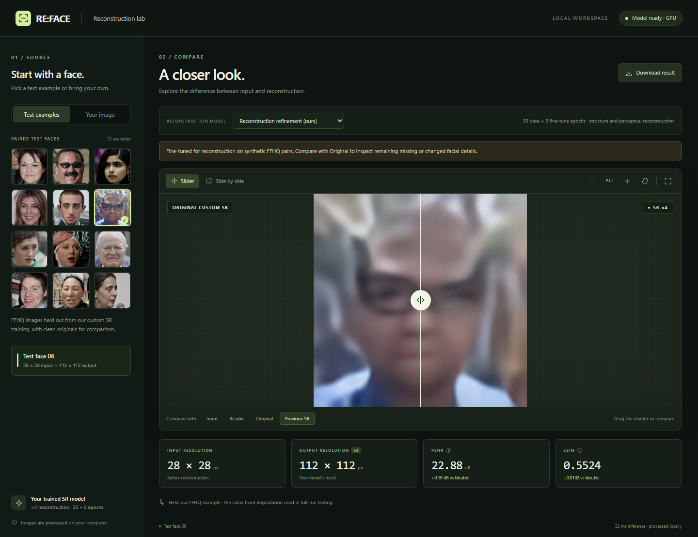

# CV_ETP — Face Super-Resolution

Reconstruct low-resolution face crops at **4× resolution** and compare the output with the input, bicubic enlargement, original custom model, and an optional clean reference. The custom model outputs an image; downstream recognition experiments are separate evaluations.

The local comparison UI includes image uploads, paired examples, a before/after slider, side-by-side comparison, zoom, PNG downloads, and reference-based PSNR/SSIM.



## Current model and results

The custom network uses sparse sampling/deformable convolutions, adaptive sparse linear attention, residual blocks and PixelShuffle. It has **479,109 parameters**. The current default retains that architecture and adds reconstruction-focused fine-tuning with pixel, structural similarity, VGG feature and multiscale-detail losses. No recognizer is used in the current training objective or checkpoint selection.

| Custom model | PSNR-Y ↑ | SSIM-Y ↑ | LPIPS-Squeeze ↓ |
|---|---:|---:|---:|
| Original, 30 epochs | 25.6829 | 0.7345 | 0.3222 |
| Previous refinement, retired | 25.4873 | 0.7190 | 0.2943 |
| Current, 30 + 5 epochs | 25.6224 | 0.7346 | 0.2509 |

These are repeated comparisons on the same 2,000-image FFHQ test split, held out from custom-model training. The current model reduces LPIPS by **22.13%** relative to the original, with essentially unchanged SSIM and a 0.0605 dB PSNR reduction. A lower perceptual distance does not establish exact recovery or human recognizability. Difficult 28 × 28 inputs remain soft.

- [Detailed quality investigation](work/visual_sr/full_reconstruction/quality_report.md)
- [Test comparison](work/visual_sr/full_reconstruction/test_comparison.png) and [additional examples](work/visual_sr/full_reconstruction/additional_examples.png)
- [Training curves](work/visual_sr/full_reconstruction/training_curves.png)
- [Original full experiment](work/full/performance_report.md)
- [Experiment design and rejected alternatives](work/visual_sr/EXPERIMENT.md)

## Run the comparison UI

The project was developed on Windows with Python 3.14 and an NVIDIA RTX 4060 Laptop GPU. Exact observed package versions are in [work/runtime_versions.json](work/runtime_versions.json); requirements include the additional UI and quality-evaluation packages. CPU inference is supported, although training was performed with CUDA.

```powershell
git clone https://github.com/Surya-Bhamidi/CV_ETP.git
cd CV_ETP
python -m venv .venv
.\.venv\Scripts\python.exe -m pip install -r requirements.txt
.\.venv\Scripts\python.exe comparison_app.py --open-browser
```

Open **http://127.0.0.1:8765**. On Windows, `Open_Comparison_UI.cmd` starts the same application. On other platforms, use your environment's `python` executable instead of the Windows `.venv\Scripts\python.exe` path. For GPU acceleration, install the appropriate matching PyTorch/CUDA wheels for your system.

The repository includes the **project-trained checkpoints**, so inference does not require retraining. The default is **Reconstruction refinement (ours)**; **Pixel model (original)** remains selectable. Active checkpoint metadata uses repository-relative paths.

Without the FFHQ cache, the app opens the upload workflow. To enable the paired test gallery, download/build the dataset:

```powershell
.\.venv\Scripts\python.exe prepare_data.py
```

This fetches the FFHQ128 archive and builds `work/data/ffhq128_u8.npy`. The archive is about 2 GB and the resulting cache about 3.4 GB, so allow space for both. Dataset: [nuwandaa/ffhq128](https://huggingface.co/datasets/nuwandaa/ffhq128), obtained from its `thumbnails128x128.zip` archive. Fixed splits are saved in `work/full/split_ids.npz`: 67,000 train, 1,000 validation, 2,000 test. HR crops are 112 × 112; degraded inputs are 28 × 28.

See [COMPARISON_UI.md](COMPARISON_UI.md) for upload limits, reference requirements and controls.

## Optional pretrained restoration

```powershell
.\.venv\Scripts\python.exe prepare_restoration.py
```

Restart the app to enable **GFPGAN 1.4 (pretrained)**. This is an external pretrained model, separate from the custom SR network. Its strength slider blends the original custom reconstruction with the generated restoration. It can make faces clearer while changing eyes, glasses, hair or other features. Its FFHQ pretraining may overlap the example images; those scores are diagnostic, not independent held-out evidence.

CodeFormer, landmark alignment and a compact general Real-ESRGAN baseline were also investigated. They produced artifacts or poorer reconstruction in the recorded trials and are not active UI choices. Their code, provenance, licenses and experiment evidence are retained.

## Training, evaluation and checks

The original notebooks are retained:

- `sr_part1_clean.ipynb`: dataset, degradation, custom SR model and original training.
- `sr_part2a_recognition.ipynb`: separate downstream recognition evaluation.
- `sr_part2b1_variants.ipynb`: model variants and ablations.

`run_project.py` executes notebook definitions without notebook download/training side effects. `audit_project.py` and `audit_visual_sr.py` check the numerical/data pipeline. Historical run manifests and checkpoints are kept intact, including their original paths and hashes. Do not overwrite an archived run with a different configuration; choose a new run name/directory.

To fine-tune a new reconstruction run from the included original checkpoint:

```powershell
.\.venv\Scripts\python.exe prepare_data.py
.\.venv\Scripts\python.exe prepare_refinement.py
.\.venv\Scripts\python.exe train_visual_sr.py --mode perceptual --name new_reconstruction --epochs 5 --train-limit 0 --val-count 1000 --batch 64
```

The preparation step downloads frozen VGG/MobileFace assets; the selected reconstruction objective uses VGG, not a recognizer. The training script expects CUDA. The original baseline can be reproduced from the first notebook using a fresh `Config.work_dir`; archived CLI runs intentionally reject mismatched resume configurations.

For quality evaluation, download the optional GFPGAN and LPIPS assets first:

```powershell
.\.venv\Scripts\python.exe prepare_restoration.py
.\.venv\Scripts\python.exe prepare_quality_metric.py
.\.venv\Scripts\python.exe evaluate_visual_sr.py --run new_reconstruction
```

Evaluation requires the dataset and all expected assets. Full recognition experiments download their own benchmark/model assets through the notebook helpers; they are not necessary for the comparison UI.

Browser tests require the development requirements and system Microsoft Edge, as used in the recorded Windows checks:

```powershell
.\.venv\Scripts\python.exe -m pip install -r requirements-dev.txt
.\.venv\Scripts\python.exe test_comparison_ui.py
.\.venv\Scripts\python.exe test_restoration_ui.py
```

## Repository contents and downloaded files

Included: source code, notebooks, UI, project-trained best/last checkpoints, split IDs, audit records, training logs, metrics, reports, plots, screenshots, external-model provenance, and third-party source licenses.

Excluded by `.gitignore`: the local Python environment, bytecode, credentials, downloaded FFHQ/LFW/QMUL datasets, large recognition embedding caches, re-downloadable third-party model binaries, incomplete downloads, and live UI PID/log state. These remain local; the preparation scripts recreate the downloads as needed. No Git LFS or paid storage is required for the included project files.

Third-party code retains its original licenses in `restoration_vendor` and `codeformer_vendor`. CodeFormer has a noncommercial S-Lab license. Dataset/model terms remain with their respective upstream sources; this repository does not redistribute the complete face datasets.
